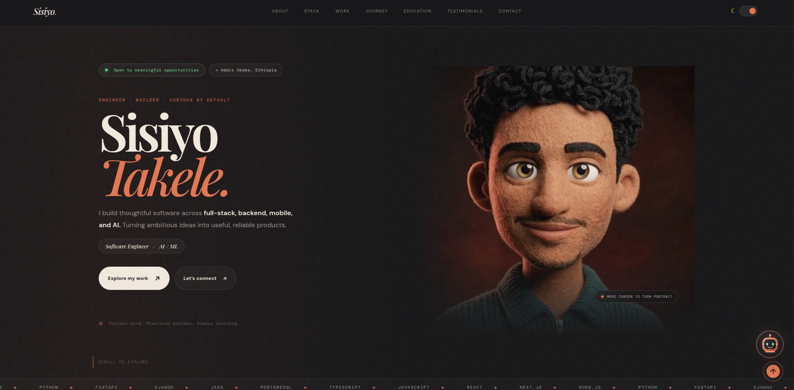

# Sisiyo Takele — Portfolio

A personal portfolio for **Sisiyo Takele**, a software engineer based in Addis Ababa, Ethiopia. It brings together selected projects, technical skills, experience, education, testimonials, and contact details in a responsive Next.js site.

    

## Portfolio preview



## Features

- Cursor-controlled animated portrait in the hero section
- Dark and light themes
- Responsive navigation and project filters
- Interactive technology stack, experience timeline, and testimonial carousel
- Portfolio chatbot with answers based on the information on the site
- Contact form connected to FormSubmit
- Custom favicon and stack icons

## Built with

- [Next.js 14](https://nextjs.org/) with the App Router for page structure and routing
- [React 18](https://react.dev/) for interactive UI components
- [TypeScript](https://www.typescriptlang.org/) for typed application code
- Custom CSS for responsive layouts, themes, transitions, and animation
- HTML5 video for the cursor-controlled hero portrait
- [FormSubmit](https://formsubmit.co/) for contact form delivery
- [Vercel](https://vercel.com/) for production hosting and continuous deployment

## Run locally

Use Node.js 18.17 or newer.

```bash
git clone https://github.com/sisiyotakele/personal_Portfolio.git
cd personal_Portfolio
npm install
npm run dev
```

Open [http://localhost:3000](http://localhost:3000).

To create a production build locally:

```bash
npm run build
npm start
```

## Deploy to Vercel

1. Import this GitHub repository in [Vercel](https://vercel.com/new).
2. Keep the detected Next.js framework and default build settings.
3. Deploy. Vercel will build new deployments when changes are pushed to the connected branch.

No environment variables are required for the site itself.

## Contact form

The form sends messages to `sisiyotakele1@gmail.com` through [FormSubmit](https://formsubmit.co/). FormSubmit asks the mailbox owner to confirm the address the first time the form is used. The confirmation must be completed before the form can deliver messages.

## Featured work

- [BankruptcySense AI](https://github.com/sisiyotakele/BankruptcySense-AI) — Company bankruptcy risk prediction with a machine learning model and dashboard.
- [Smart Bus Transportation System](https://github.com/sisiyotakele/AI-BASED-SMART-BUS-TRANSPORTATION-SYSTEM-SBTS) — Transit tracking and ETA prediction with real-time updates and AI services.
- [Clearance Management](https://github.com/sisiyotakele/Clearance-managment) — A multi-role university clearance workflow application.
- [Digital Identity Platform](https://github.com/sisiyotakele/digital-identity-platform-) — Digital business cards with QR codes, NFC, and analytics.
- [Food Preservation](https://github.com/sisiyotakele/Food_Preservation) — Food-storage monitoring connected to ESP32 hardware.
- [PanSave](https://github.com/sisiyotakele/PanSave) — Digital tools for rotating community savings groups.

## Connect

- [GitHub](https://github.com/sisiyotakele)
- [LinkedIn](https://www.linkedin.com/in/sisiyo-takele1/)
- [Email](mailto:sisiyotakele1@gmail.com)

---

© Sisiyo Takele. All rights reserved.
